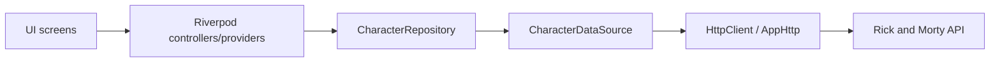
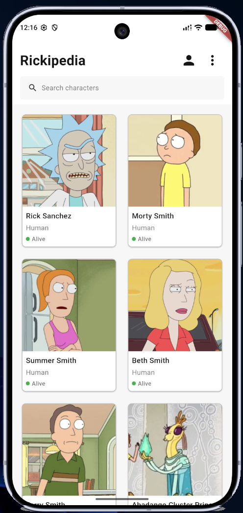
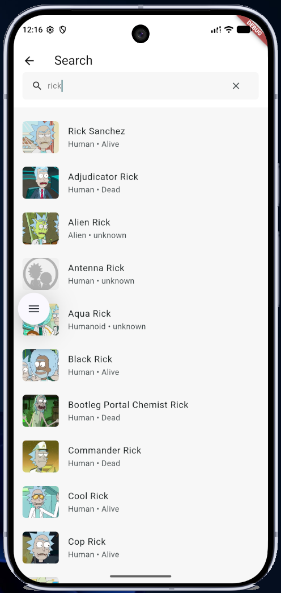
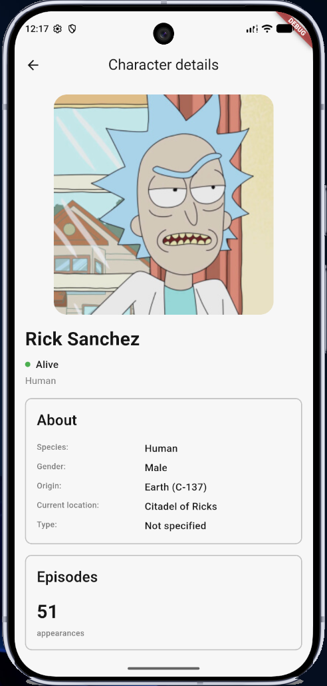
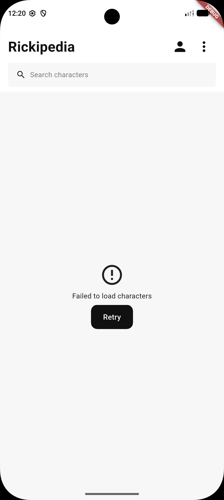
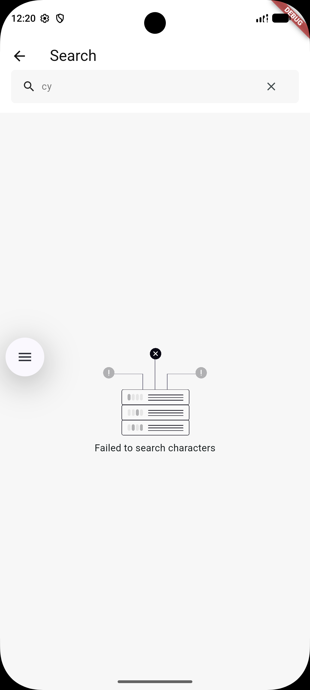
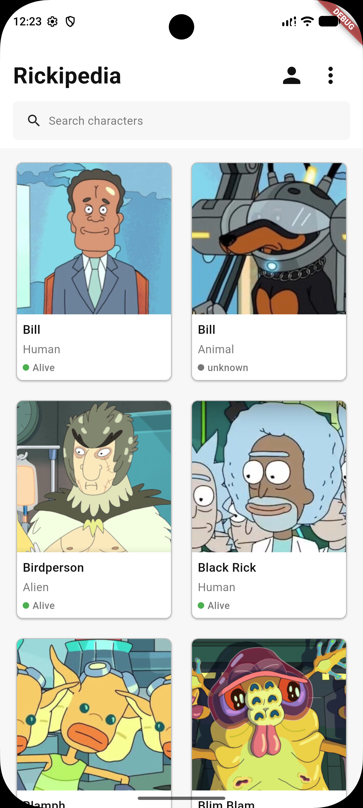
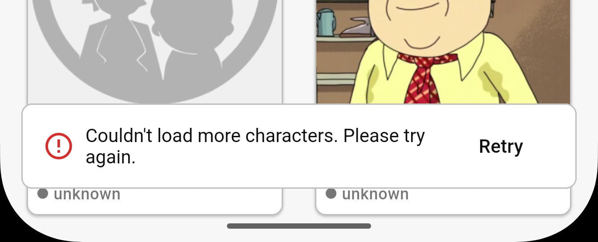

# Rickipedia

Rickipedia is a Flutter app for browsing and searching Rick and Morty characters using the [Rick and Morty API](https://rickandmortyapi.com/). The v1.0 character experience includes a paginated grid, basic name search, and a shared details screen. No account, authentication, API key, or environment file is required.

## Set up and run

Verified locally on Windows on 2026-10-13: **Flutter 3.47.4 stable**, **Dart 3.13.3**. The existing CI workflow pins Flutter 3.47.4; `pubspec.yaml` requires Dart `^3.13.3`. Install this Flutter SDK and add its `bin` directory to your PATH. Keep `pubspec.lock` for reproducible dependency resolution.

```sh
git clone https://github.com/itumelengseema/rickipedia.git
cd rickipedia
flutter --version
flutter doctor
flutter pub get
flutter devices
flutter run -d <device-id>
```

Replace `<device-id>` with an ID from `flutter devices`. For Android, configure the Android SDK and start an emulator or connect a device; the app already declares Internet permission. For browser development, install Chrome and run:

```sh
flutter run -d chrome
```

Character requests and remote portraits need Internet access. Platform folders are present for Android, iOS, web, Windows, Linux, and macOS; their presence does not mean each platform has been validated for release. iOS/macOS development requires macOS and the corresponding Apple tooling. Release platform validation belongs to [#24](https://github.com/itumelengseema/rickipedia/issues/24); responsive web improvements are later work.

## Implemented v1.0 behavior

| Flow | What the app does today |
| --- | --- |
| Browse | Opens a two-column character grid. Cards show portrait, name, species, and status. Initial requests show a spinner; an empty response shows “No characters found”. |
| Pagination | Scrolling within 300 pixels of the bottom requests the page from the API's `next` URL. Results append in order with duplicate IDs removed. Requests stop at `next == null`; concurrent page requests are blocked. A footer spinner indicates loading. Failure retains the current cards and shows a snackbar with Retry. |
| Refresh | Pull down on the grid, including when content is too short to scroll, to request page 1. The grid is replaced by a loading state while refreshing; success replaces accumulated results and metadata. Failure shows the full-page error and Retry. Pagination is blocked during refresh, and results/errors from older page requests are ignored. |
| Basic search | Tap the home search bar to open Search. A trimmed name needs at least two characters. Requests start after a 500 ms debounce; stale responses cannot replace newer searches. Results show portrait, name, species, and status. Clear restores the initial instruction. |
| Details | Tap a grid card or search result to open the same details page. It uses the selected `Character` without an extra API request. Shows portrait, name, status, species, gender, origin, current location, type, and episode appearance count. Blank About values show “Not specified”; other API values, including “unknown”, are retained. The layout scrolls; Back returns to the originating screen. |
| Errors | Initial browsing and refresh errors offer Retry. Search errors show “Failed to search characters” without a dedicated Retry action. Grid/details portraits have loading indicators; failed portraits show a broken-image icon, including in search results. |

Refresh retention described in [#5](https://github.com/itumelengseema/rickipedia/issues/5) is not present in the merged controller: it sets `AsyncLoading()` without retaining the previous response. The table above describes the checked-in implementation. Details and both navigation entry points from [#15](https://github.com/itumelengseema/rickipedia/issues/15) are implemented.

### Search limitations and planned features

v1.0 searches **characters by name only** and displays **the first page of matching results**. It does not fetch subsequent search pages, even when the API reports more matches. There is no dedicated search Retry until v1.1; edit the query to make another request, or clear it and re-enter the name. Back from details retains the search field and results while the search screen remains on the navigation stack.

Planned features, not current functionality:

- Episode lists, episode details, and episode fetching; today's episode section is an informational count only.
- Global search beyond basic character-name lookup.
- Search pagination.
- Dedicated search Retry in v1.1.
- Search history.

Inactive profile and menu controls have been removed. Authentication is outside v1.0 scope.

## Architecture



`main.dart` wraps the app in `ProviderScope`. Screens watch Riverpod `AsyncValue` state and call controller methods for refresh, pagination, and search. `CharacterController` owns browsing results; `paginationStateProvider` tracks page loading/errors. `CharacterSearchController` owns search state, debounce timing, and stale-response protection.

`character_providers.dart` wires `CharacterRepositoryImpl` to `CharacterRemoteDataSource`, then to the project's `HttpClient` interface. The repository delegates character fetching to the data source. The data source constructs `/api/character/?page=…&name=…`, checks HTTP status, and decodes JSON into `CharacterResponse`/`Character`. The API's recognized “There is nothing here” search 404 becomes an empty result; other failures propagate into Riverpod error state. `AppHttp` uses `package:http` with a 15-second timeout and closes its owned client when its provider is disposed. Portraits load separately through `CachedNetworkImage`.

| Directory | Purpose |
| --- | --- |
| `lib/app/`, `lib/main.dart` | App entry point and Material theme setup |
| `lib/features/character/views/` | Browse, search, and details screens |
| `lib/features/character/providers/` | State controllers and dependency wiring |
| `lib/features/character/repositories/` | Repository interface and implementation |
| `lib/features/character/data/` | Data-source interface and API/JSON handling |
| `lib/features/character/models/` | Character, origin, location, response, and pagination models |
| `lib/core/network/` | HTTP abstraction and implementation |
| `lib/shared/widgets/`, `lib/theme/` | Shared UI, colors, spacing, and text styles |
| `test/` | Unit/widget tests, fake dependencies, and JSON fixtures |

Tests override repository/data-source/HTTP dependencies, so they do not require the live API. Navigation tests exercise taps on actual grid cards and search results, verify the selected character, and return to the original screen.

## Development checks

Run from the repository root:

```sh
flutter pub get
dart format lib test tool
dart format --output=none --set-exit-if-changed lib test tool
flutter analyze
flutter test
```

For coverage, run `flutter test --coverage`; the output is `coverage/lcov.info`. To run only the screen tests, use `flutter test test/features/character/views`.

Local verification on 2026-10-13 passed dependency resolution, formatting checks, `flutter analyze`, all 79 app tests, the screenshot capture, and `flutter build web --no-pub`. A successful web build is not a browser interaction test or release certification for the other platforms.

The current [Flutter CI workflow](.github/workflows/flutter.yml) runs on pushes and pull requests, installs Flutter 3.47.4 with caching, resolves dependencies, analyzes, and tests. Formatting enforcement, coverage summaries/artifacts, and a verified protection check name are owned by [#14](https://github.com/itumelengseema/rickipedia/issues/14); they are not yet steps in this workflow.

## Screenshots

These are the seven supplied app screenshots, preserved as provided, including device frames, debug banners, overlays, and the cropped pagination error. Some show the profile/menu controls from before their removal in this documentation change. See [screenshot notes](docs/screenshots/README.md) for the file mapping and the separate reproducible widget captures.

| Browsing | Search | Details |
| --- | --- | --- |
|  |  |  |

| Browse error with Retry | Search error without Retry | Additional browsing results |
| --- | --- | --- |
|  |  |  |

Pagination error with Retry:



## CI and release references

Versioning, branch promotion, release candidates, release validation, hotfixes, rollback, and publication belong to [Define versioning, branch promotion and the v1.0 release process (#24)](https://github.com/itumelengseema/rickipedia/issues/24). That issue owns the future `docs/RELEASE_STRATEGY.md` and `CHANGELOG.md`; neither exists in this checkout yet. Follow that source when it is completed rather than treating this README as a release procedure. `pubspec.yaml` currently declares `1.0.0+1`; this does not by itself indicate a published or validated v1.0 release.
